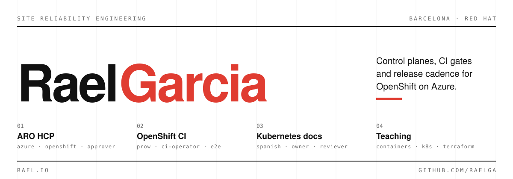

  

I work on Azure Red Hat OpenShift Hosted Control Planes, the managed OpenShift service on Azure where the control plane runs inside the customer's subscription. Most of my time goes to CI, E2E coverage and service lifecycle: the parts that decide whether a control plane can be released on a schedule. In my spare time I teach Kubernetes whenever I can, and I keep the lab material in the open so other people can reuse it.

### Where I work upstream

- [Azure/ARO-HCP](https://github.com/Azure/ARO-HCP/blob/main/OWNERS_ALIASES): approver for service lifecycle, plus `acm/`, `config/` and `observability/`.
- [openshift/release](https://github.com/openshift/release/tree/main/ci-operator/jobs/Azure/ARO-HCP): OWNERS for the ARO HCP and ARO-Tools ci-operator config and jobs, the Prow config behind them, and the `aro-hcp/hypershift-e2e` step registry.
- [kubernetes/website](https://github.com/kubernetes/website/blob/main/OWNERS_ALIASES): owner and reviewer for the Spanish localization.

### Teaching material

The labs I teach with are public: containers, Kubernetes and Terraform, each written with prerequisites, execution, verification and cleanup. [Course labs](https://github.com/raelga/kubernetes-talks/tree/main/course)

### Elsewhere

[rael.io](https://rael.io) | [talks](https://github.com/raelga/kubernetes-talks) | [Cloud Native Barcelona](https://cloudnative.barcelona)
