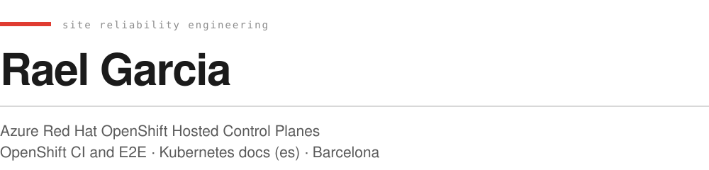

  

  
  
  

I work on Azure Red Hat OpenShift Hosted Control Planes, the managed OpenShift service on Azure where the control plane runs inside the customer's subscription. My day is CI, E2E coverage and service lifecycle: the parts that decide whether a control plane can be released on a schedule.

### Upstream roles

- [Azure/ARO-HCP](https://github.com/Azure/ARO-HCP/blob/main/OWNERS_ALIASES): approver for service lifecycle, plus `acm/`, `config/` and `observability/`.
- [openshift/release](https://github.com/openshift/release/tree/main/ci-operator/jobs/Azure/ARO-HCP): OWNERS for the ARO HCP and ARO-Tools ci-operator config and jobs, the Prow config behind them, and the `aro-hcp/hypershift-e2e` step registry.
- [kubernetes/website](https://github.com/kubernetes/website/blob/main/OWNERS_ALIASES): owner and reviewer for the Spanish localization.

### Teaching

I teach cloud infrastructure and Kubernetes, and I keep the lab material open so it can be reused or translated: containers, Kubernetes and Terraform labs, each written with prerequisites, execution, verification and cleanup. [Course labs](https://github.com/raelga/kubernetes-talks/tree/main/course)

### Elsewhere

[rael.io](https://rael.io) | [talks](https://github.com/raelga/kubernetes-talks) | [Cloud Native Barcelona](https://cloudnative.barcelona)
